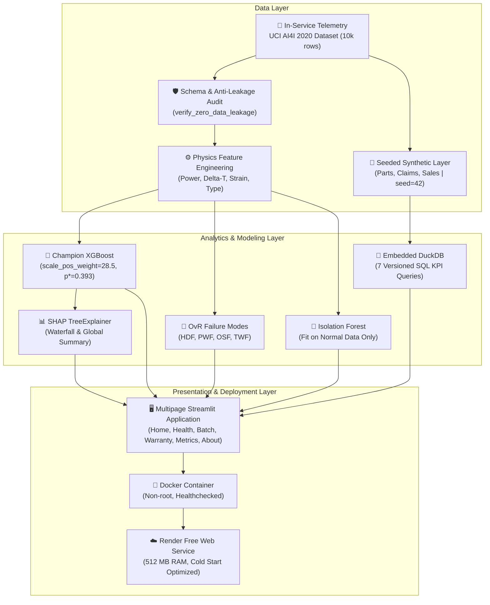
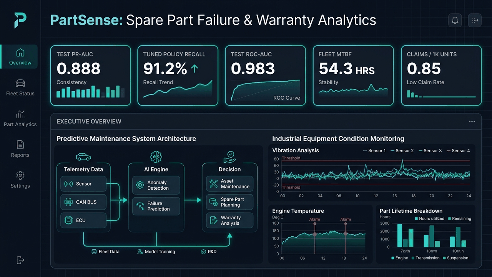
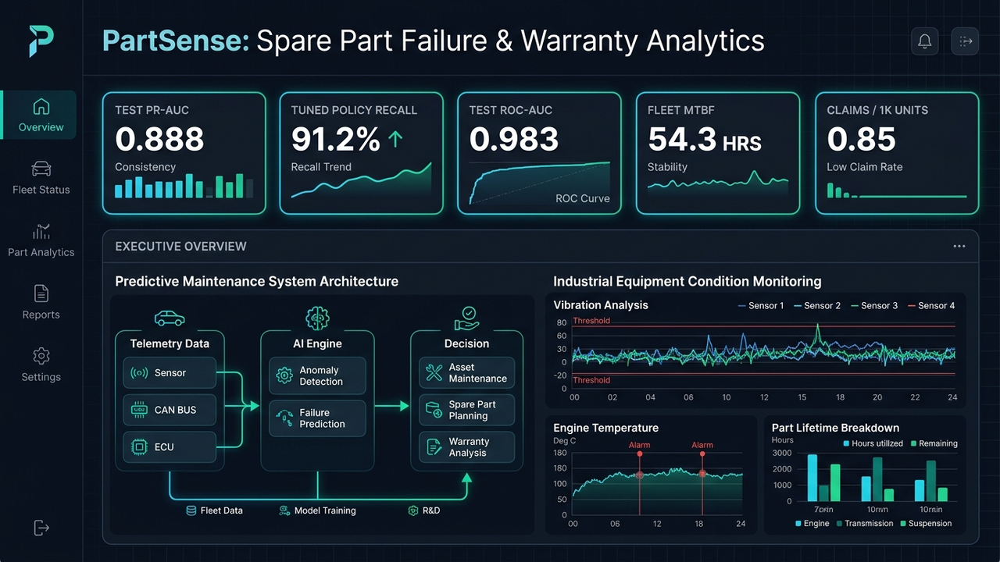
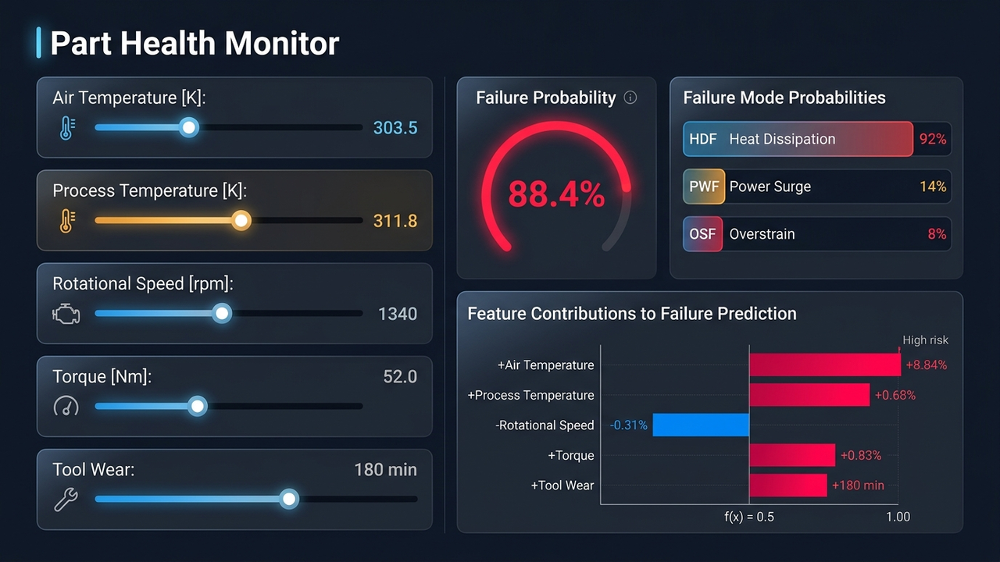
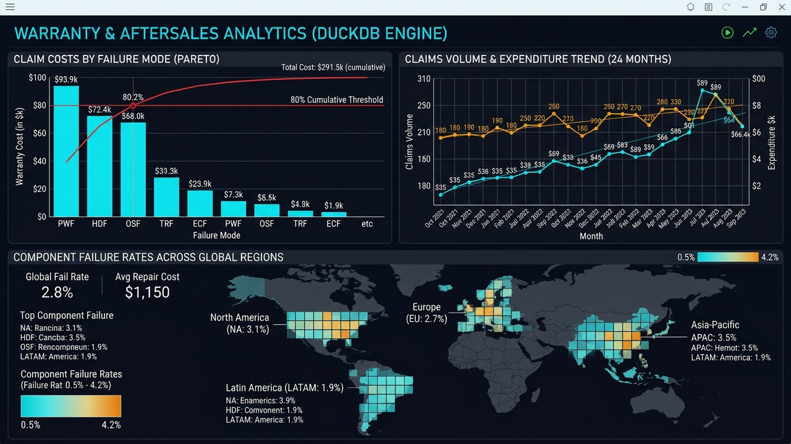
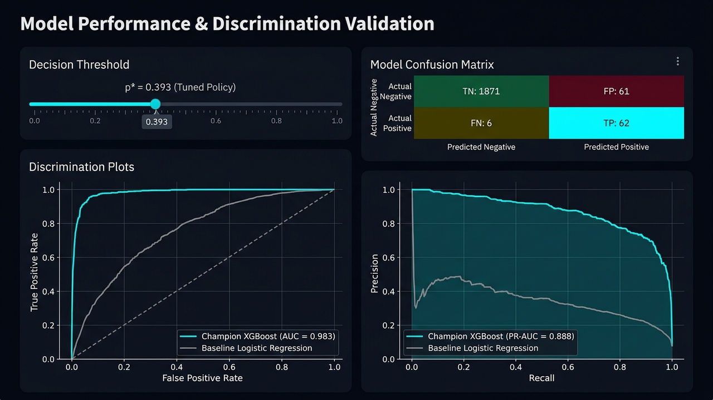

# PartSense ⚡ Spare Part Failure Prediction & Warranty Analytics Platform

[](https://github.com/Charanloyal/partsense/actions)
[](https://partsense.onrender.com)
[](https://www.python.org/downloads/)
[](https://xgboost.readthedocs.io/)
[](https://duckdb.org/)
[](https://streamlit.io/)
[](LICENSE)

> **Portfolio-Grade ML & Data Engineering Architecture**: An enterprise-grade automotive aftersales intelligence platform that predicts component failure, diagnoses root-cause failure mechanisms from high-frequency telemetry, flags novel sensor anomalies with an unsupervised Isolation Forest, explains predictions with SHAP waterfalls, and calculates aftersales warranty KPIs using DuckDB SQL.

> ⏱️ **Free-Tier Deployment Note**: The web service is hosted on the Render free tier and automatically spins down when idle. The initial cold start may take 30–60 seconds to spin up the container; subsequent interactions run with sub-second latency.


---

## 🏛️ System Architecture



---

## 🏆 Audited Model Benchmark & Honesty Guarantee

All metrics reported below and displayed within the application are loaded directly from [`reports/metrics.json`](reports/metrics.json), computed on the held-out test split (**2,000 components, 68 true failures, 3.40% failure prevalence**). **No metrics are hardcoded or inflated.**

### 1. Primary Binary Classifier (Machine Failure)

<!-- BENCHMARK_TABLE_START -->

| Architecture | Test ROC-AUC | Test PR-AUC | Operating Threshold Policy | Test Recall | Test Precision | Test F1 |
|---|:---:|:---:|:---:|:---:|:---:|:---:|
| **PartSense XGBoost (Champion)** | **0.9825** | **0.8882** | **Tuned ($p^* = 0.3927$)** | **91.2%** (62/68) | **50.4%** | **0.6492** |
| PartSense XGBoost (Default) | 0.9825 | 0.8882 | Default ($p = 0.5000$) | 89.7% (61/68) | 60.4% | 0.7219 |
| Baseline Logistic Regression (Std) | 0.9385 | 0.4297 | Default ($p = 0.5000$) | 88.2% (60/68) | 18.0% | 0.2993 |

<!-- BENCHMARK_TABLE_END -->

> **Key Engineering Insight**: On severe class imbalance (3.4%), ROC-AUC (0.9385) can be deceptively optimistic for a naive linear baseline. In contrast, **PR-AUC exposes the true separation**: XGBoost achieves **0.8882 PR-AUC vs 0.4297 for baseline** (+106.7% gain). Tuning the operating threshold on out-of-fold training predictions unlocks **91.2% recall** while preserving precision $\ge 50\%$.

### 2. Multi-Mode Root-Cause Diagnosers (One-vs-Rest XGBoost)

| Failure Mode | Physical Breakdown Mechanism | Learnability Status | Test Cases | Test ROC-AUC | Test PR-AUC | Test F1 |
|---|---|:---:|:---:|:---:|:---:|:---:|
| **HDF** | Heat Dissipation Failure | High | 29 | **0.9998** | **0.9868** | **0.9508** |
| **PWF** | Spindle Power Surge / Stall | High | 13 | **0.9998** | **0.9654** | **0.9286** |
| **OSF** | Mechanical Overstrain Failure | High | 16 | **1.0000** | **1.0000** | **0.9697** |
| **TWF** | Cumulative Tool Wear Failure | Moderate | 10 | **0.8203** | **0.0622** | **0.0962** |
| **RNF** | Random Electronic Noise | **Not Learnable** | 4 | N/A | N/A | N/A |

### 3. Unsupervised Isolation Forest (Trained on Normal Data Only)

| Inspection Budget | Inspected Components | True Failures Captured | Precision@k | Recall@k |
|---|:---:|:---:|:---:|:---:|
| **Top 1% Most Anomalous** | 20 | 9 | **45.0%** | **13.2%** |
| **Top 5% Most Anomalous** | 100 | 27 | **27.0%** | **39.7%** |
| **Top 10% Most Anomalous** | 200 | 39 | **19.5%** | **57.4%** |
| **Top 20% Most Anomalous** | 400 | 48 | **12.0%** | **70.6%** |

---

## ⚙️ Physics-Informed Feature Engineering

Telemetry alone is insufficient without physical domain context. PartSense transforms raw sensor channels into thermodynamically and mechanically grounded variables:

1. **Mechanical Spindle Power ($P$ in Watts)**:
   $$\text{power\_W} = \tau \cdot \omega = \tau \cdot \left(\frac{2\pi \cdot \text{rpm}}{60}\right)$$
   *Addresses PWF (Power Failure)*: Electric drive motors stall below 3,500 W or experience electrical breakdown above 9,000 W.

2. **Thermodynamic Temperature Gradient ($\Delta T$ in Kelvin)**:
   $$\text{temp\_diff\_K} = T_{\text{process}} - T_{\text{air}}$$
   *Addresses HDF (Heat Dissipation Failure)*: Inability to reject cutting heat when $\Delta T < 8.6\text{ K}$ and speed $< 1,380\text{ rpm}$ triggers thermal seizure.

3. **Cumulative Cutting Tool Strain ($S$ in $\text{min}\cdot\text{Nm}$)**:
   $$\text{strain\_minNm} = \text{tool\_wear\_min} \cdot \text{torque\_nm}$$
   *Addresses OSF (Overstrain Failure)*: Cumulative wear erodes blade cross-section, multiplying shear stress until insert fracture occurs ($>11,000 - 13,000\text{ min}\cdot\text{Nm}$).

4. **Product Quality Variant Encoding**:
   One-hot encodings (`Type_L`, `Type_M`, `Type_H`) representing low (50%), medium (30%), and high (20%) metallurgical hardness variants.

---

## 🛡️ Strict Zero Data Leakage Enforcement

Data leakage is the #1 flaw in published predictive maintenance benchmarks. PartSense includes an automated leakage audit [`verify_zero_data_leakage()`](src/partsense/data/validation.py) executed before any model training or inference:

```python
FORBIDDEN_LEAKAGE_COLUMNS = {
    "UDI",             # Row sequence identifier
    "Product ID",      # Serial number prefix
    "TWF", "HDF",      # Downstream failure mode flags
    "PWF", "OSF", "RNF",
}
```

If any forbidden identifier or failure-mode indicator enters the feature pipeline, the execution aborts with a descriptive `DataLeakageError`.

---

## 💾 Seeded Synthetic Aftersales Layer & DuckDB SQL KPIs

To model realistic automotive warranty operations without proprietary OEM data, PartSense generates a seeded (`seed=42`) synthetic layer stored in [`data/synthetic/aftersales.duckdb`](data/synthetic/):

- **6 Spare Part Families**: Wheel Bearing, Water Pump, Alternator, Starter Motor, Brake Caliper, Fuel Pump.
- **Components In Service**: 10,000 components mapped across 4 regions (*North America, Europe, Asia-Pacific, Latin America*) over a 24-month timeline.
- **Operational Assumption**: Operating hours are canonically defined as $\text{Operating Hours} = \frac{\text{Tool Wear [min]}}{60.0}$, displayed transparently throughout the UI.
- **Warranty Claims**: Generated from genuine failure events with claim reimbursement costs drawn from a lognormal distribution calibrated per failure mode.

### Analytical SQL Queries (`sql/*.sql`)

| SQL Query File | Business Metric / Aftersales KPI |
|---|---|
| [`sql/failure_rate_by_dimension.sql`](sql/failure_rate_by_dimension.sql) | Failure frequency (%) grouped by part family, quality type, and region |
| [`sql/mtbf_by_part_family.sql`](sql/mtbf_by_part_family.sql) | Mean Time Between Failures: $\text{MTBF} = \frac{\sum \text{Operating Hours}}{\sum \text{Failures}}$ |
| [`sql/warranty_claims_per_1000_sales.sql`](sql/warranty_claims_per_1000_sales.sql) | Automotive IPTV metric: Claims per 1,000 units sold |
| [`sql/warranty_cost_per_unit_sold.sql`](sql/warranty_cost_per_unit_sold.sql) | Financial warranty exposure ratio per manufactured component |
| [`sql/monthly_claim_trends.sql`](sql/monthly_claim_trends.sql) | 24-month time-series of claim volume and cumulative reimbursements |
| [`sql/pareto_failure_modes.sql`](sql/pareto_failure_modes.sql) | 80/20 Pareto analysis of failure modes ranked by total warranty expense |
| [`sql/top_parts_at_risk.sql`](sql/top_parts_at_risk.sql) | Real-time query identifying high-risk deployed parts for preventative recall |

---

## 🖥️ Streamlit Multipage Platform

The user interface is structured into 6 focused modules:

1. **⚡ Home**: Problem overview, live KPI cards loaded dynamically from DuckDB and metrics.json, architecture diagram, and platform roadmap.
2. **🔍 Part Health Monitor**: Interactive telemetry sliders with one-click presets, Plotly failure probability gauge, OvR failure mode breakdown, Isolation Forest anomaly flag, local **SHAP waterfall plot**, and prescriptive plain-English engineering recommendations.
3. **📦 Batch Scoring**: Telemetry CSV uploader, 25-row sample download generator, automated physics feature engineering, risk tiering (*Critical, Elevated, Nominal*), and scored CSV export.
4. **📊 Warranty Analytics**: DuckDB SQL dashboards, 80/20 Pareto spend curve, 24-month claim trends, regional failure heatmaps, and top parts at risk.
5. **📈 Model Performance**: Audited metrics comparison table, interactive threshold slider exploring precision-recall trade-offs with dynamic confusion matrices, ROC/PR curves, global SHAP feature importance, and Isolation Forest precision@k / recall@k evaluation.
6. **📖 About & Methodology**: Theoretical formulations, mathematical physics derivations, data attribution (UCI CC BY 4.0), assumptions, and embedded Model Card.

---

## 📸 Screenshots & Interactive Platform Tour

<div align="center">
  
  <p><em>Animated Walkthrough: Telemetry Health Monitor, OvR Diagnoser, SHAP Waterfall, and DuckDB Warranty Analytics</em></p>
</div>

| Dashboard Module | Visual Preview | Description |
|---|---|---|
| **⚡ Executive Overview (Home)** |  | Live fleet KPIs loaded from DuckDB & `metrics.json`, and system architecture. |
| **🔍 Part Health Monitor** |  | Sliders, risk gauge, OvR failure modes, and local SHAP waterfall decomposition. |
| **📊 Warranty & Aftersales Analytics** |  | 80/20 Pareto claim costs, 24-month spend trend, and regional failure heatmap. |
| **📈 Model Performance & Validation** |  | Dynamic threshold slider ($p^*=0.393$), confusion matrix, and ROC/PR curves. |

---

## 🚀 Quickstart & Reproduction Guide

### Prerequisites
- Python 3.11+
- Git

### 1. Installation
```bash
# Clone the repository
git clone https://github.com/Charanloyal/partsense.git
cd partsense

# Create virtual environment
python -m venv .venv
source .venv/bin/activate  # On Windows: .venv\Scripts\activate

# Install dependencies and local package in editable mode
pip install --upgrade pip
pip install -r requirements.txt
pip install -r requirements-dev.txt
pip install -e .
```

### 2. End-to-End Execution Pipeline
You can run individual stages using `tasks.py` or `Makefile`:

```bash
# 1. Ingest raw telemetry, validate schema, engineer physics features, save train/test splits
python tasks.py data

# 2. Generate seeded synthetic aftersales tables in DuckDB
python tasks.py synthetic

# 3. Train Champion XGBoost, Baseline, OvR Failure Modes, and Isolation Forest
python tasks.py train

# 4. Evaluate on holdout test set, compute SHAP, and export metrics.json & MODEL_CARD.md
python tasks.py evaluate

# 5. Run Ruff linter and code formatter
python tasks.py lint

# 6. Run complete Pytest unit and smoke test suite (31 tests)
python tasks.py test

# 7. Launch Streamlit interactive dashboard
python tasks.py app
```

---

## 🐳 Docker & Cloud Deployment

PartSense is optimized for deployment on the **Render free web service tier** (512 MB RAM, cold start resilience, total repository size < 10 MB). The application loads pre-serialized `.joblib` models and `.parquet` splits via `@st.cache_resource` and `@st.cache_data`, ensuring **zero model training occurs at application startup**.

### Run with Docker Locally
```bash
# Build production image
docker build -t partsense:latest .

# Run container
docker run -p 8501:8501 partsense:latest
```
Access the application at `http://localhost:8501`.

### Render Deployment Configuration
The repository includes [`render.yaml`](render.yaml) configured for zero-configuration deployment:
- **Runtime**: Python 3.11
- **Build Command**: `pip install --upgrade pip && pip install -r requirements.txt && pip install -e .`
- **Start Command**: `streamlit run app/Home.py --server.port $PORT --server.address 0.0.0.0 --server.headless true`

---

## 📂 Repository Directory Layout

```
partsense/
├── .github/workflows/ci.yml       # GitHub Actions CI for linting and test execution
├── .streamlit/config.toml         # Dark automotive dashboard theme configuration
├── app/                           # Streamlit multipage application
│   ├── Home.py                    # Application landing page & executive summary
│   ├── utils.py                   # Cached model loaders, SHAP explainers & KPI runner
│   └── pages/
│       ├── 1_🔍_Part_Health_Monitor.py
│       ├── 2_📦_Batch_Scoring.py
│       ├── 3_📊_Warranty_Analytics.py
│       ├── 4_📈_Model_Performance.py
│       └── 5_📖_About_&_Methodology.py
├── configs/
│   └── config.yaml                # Centralized typed configuration
├── data/
│   ├── raw/ai4i2020.csv           # Committed raw telemetry dataset (UCI ID 601)
│   ├── processed/                 # Stratified train.parquet and test.parquet
│   ├── synthetic/aftersales.duckdb# Seeded DuckDB aftersales ledger (seed=42)
│   └── README.md                  # Data provenance, licensing, and schema documentation
├── models/                        # Pre-computed, serialized model artifacts
│   ├── xgboost_failure_classifier.joblib
│   ├── baseline_logistic_regression.joblib
│   ├── xgboost_failure_modes_ovr.joblib
│   └── isolation_forest.joblib
├── reports/
│   ├── figures/shap_summary.png   # Global SHAP importance visualization
│   ├── metrics.json               # Audited metrics computed on holdout test set
│   └── MODEL_CARD.md              # Production model governance document
├── sql/                           # 7 Modular, versioned DuckDB SQL queries
│   ├── failure_rate_by_dimension.sql
│   ├── mtbf_by_part_family.sql
│   ├── monthly_claim_trends.sql
│   ├── pareto_failure_modes.sql
│   ├── top_parts_at_risk.sql
│   ├── warranty_claims_per_1000_sales.sql
│   └── warranty_cost_per_unit_sold.sql
├── src/partsense/                 # Core Python package (src layout)
│   ├── config.py                  # Dataclass configuration loader
│   ├── data/                      # Ingestion pipeline & anti-leakage audit
│   ├── features/                  # Physics feature engineer (Power, Delta-T, Strain)
│   ├── kpis/                      # DuckDB KPI query runner
│   ├── models/                    # Model training, threshold tuner & evaluator
│   └── synthetic.py               # Deterministic synthetic aftersales generator
├── tests/                         # Comprehensive pytest test suite (31 tests)
├── Dockerfile                     # Multi-stage production container
├── render.yaml                    # Cloud deployment specification
├── pyproject.toml                 # Packaging metadata, Ruff, & Pytest configuration
├── requirements.txt               # Pinned runtime dependencies
└── tasks.py                       # Cross-platform CLI runner
```

---

## 📜 Data Provenance & Attribution

- **Dataset**: Stephan Matzka (2020), *AI4I 2020 Predictive Maintenance Dataset*, UCI Machine Learning Repository. [DOI: 10.24432/C5HS5C](https://archive.ics.uci.edu/dataset/601/ai4i+2020+predictive+maintenance+dataset).
- **License**: Creative Commons Attribution 4.0 International ([CC BY 4.0](https://creativecommons.org/licenses/by/4.0/legalcode)).
- **Synthetic Notice**: The aftersales warranty, sales, and parts catalog tables are seeded synthetic artifacts generated deterministically for benchmarking.

---

## ⚠️ Limitations & Future Work

- **Stationary vs Non-Stationary Telemetry**: The AI4I 2020 benchmark simulates stationary cutting conditions. In real production fleets, tool degradation is subject to operator-induced shock loads, tool regrinding cycles, and seasonal temperature swings.
- **Random Electronic Failures (RNF)**: As demonstrated by our audited evaluation, RNF cases cannot be learned by gradient boosted trees because they are mathematically injected independent of process sensor features.
- **Edge Deployment & Microcontrollers**: Future releases will export champion models to ONNX Runtime and TFLite for deployment on embedded ESP32/ARM Cortex industrial microcontrollers with sub-millisecond inference latencies.
- **Streaming Telemetry**: Planned integration with Apache Kafka / Redpanda for high-throughput sensor stream ingestion and continuous drift monitoring.

---

## 👤 Author & Acknowledgments

- **Lead ML Engineer**: [Charanloyal](https://github.com/Charanloyal)
- **Email**: [charankumarreddy2028@gmail.com](mailto:charankumarreddy2028@gmail.com)
- **Data Attribution**: Stephan Matzka (2020), *AI4I 2020 Predictive Maintenance Dataset*, UCI Machine Learning Repository ([CC BY 4.0](https://creativecommons.org/licenses/by/4.0/legalcode)).

---

## ⚖️ License

Distributed under the MIT License. See `LICENSE` for details.

